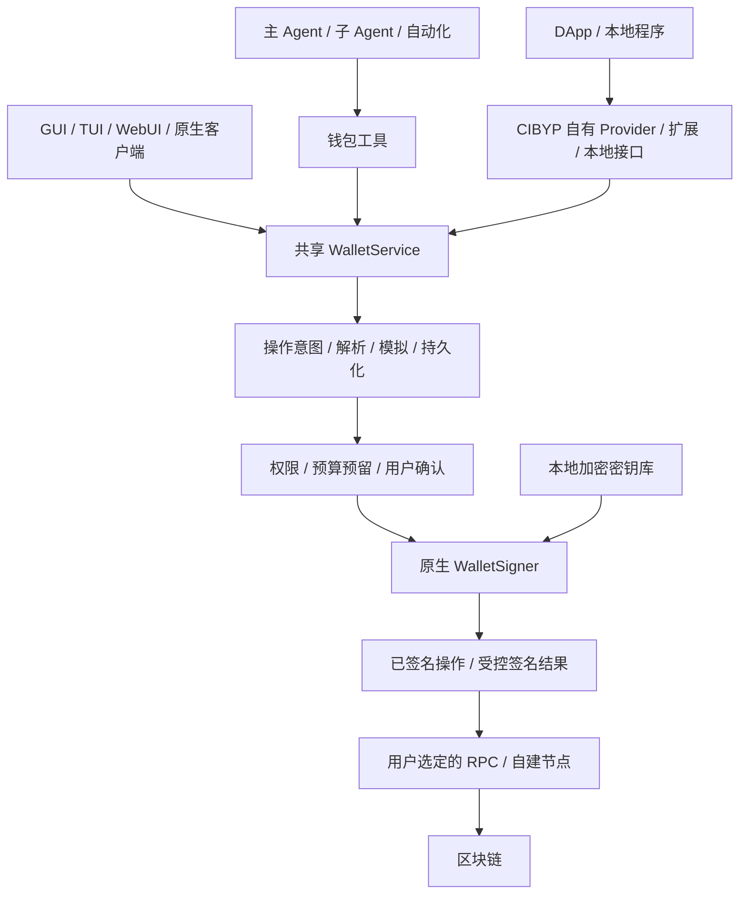

# CIBYP 原生 Agent 钱包规划

状态：评审草案 · 2026-10-25

代码基线：桌面仓库 `2fce058`。本文是完整目标规划；当前开发实现及尚未实现的范围见[原生钱包与量化工作台](quant-wallet-guide.md)，不代表下列所有能力已经交付。

## 1. 已确定的方向

按用户最新要求，采用 **CIBYP 内置原生钱包**：用户在本地创建、导入、解锁钱包，Agent 通过工具准备和执行操作，原生签名器直接签名，交易发往用户指定的区块链节点。

产品不接入 WalletConnect、Reown、第三方账号登录、托管钱包或钱包中继，不要求项目 ID、CIBYP 云账号或中心化支付服务。标准密码学和序列化使用经过选型审查的开源实现；这与接入第三方钱包服务是两件事，不自行发明密码算法。

“登录钱包”在这里是**解锁本地密钥库**，不是向链提交账号密码。已有钱包通过兼容的助记词、私钥或加密导出文件恢复；只有地址的账户作为观察钱包。非导出型硬件钱包、MPC 账户等不能靠一个品牌登录密码变成本地私钥，需采用该签名设备/账户实际支持的本地接口。

去中心化落实到：用户控制密钥、可选择自建节点、没有强制中继、可导出恢复、协议和数据格式公开。广播仍然需要链节点；使用公共 RPC 时须显示运营方依赖，不称其为完全自托管。完全自托管模式由用户配置自己的节点，离线模式可生成、签署和导出交易，联网后再广播。

## 2. 用户体验与执行模式

首次入口：**钱包 → 创建 / 导入 / 观察账户 → 备份确认 → 选择链和 RPC → 授予当前 Agent 使用范围**。账户显示用户自定义名称、链、地址和锁定状态，普通操作使用选择列表。

| 模式             | Agent 能力                                                   | 签名方式                                         |
| ---------------- | ------------------------------------------------------------ | ------------------------------------------------ |
| 观察             | 余额、资产、交易状态、合约读取、模拟                         | 不具备签名权限                                   |
| 逐笔确认（默认） | 准备转账、合约调用、消息证明和应用操作                       | 用户在可信钱包界面确认准确的操作内容后，本地签名 |
| 限额自主执行     | 在指定账户、链、资产、目标、方法、金额、费用和期限内自动执行 | 签名器执行策略；有条件时叠加链上限权账户/授权    |

自主执行也覆盖无人值守任务，不要求每次都弹窗。用户先授权账户和策略，超出范围时暂停等待决定；主 Agent 与子 Agent 共用预算，子 Agent 的权限只能缩小。

默认把日常主钱包和 Agent 执行账户分开。二者可以属于同一助记词，但备份、派生路径与资金风险仍需准确展示，不能把派生子账户描述成与根助记词泄漏完全隔离。

## 3. “任何钱包、链和应用”的实现边界

采用开放适配器，而不是承诺任意品牌、链和应用天然兼容。界面按“可观察 / 可构建 / 可模拟 / 可签名 / 可广播 / 可授权 / 已实测”展示能力。

| 层次     | 原生实现方向                                                                  | 明确的边界                                                |
| -------- | ----------------------------------------------------------------------------- | --------------------------------------------------------- |
| 钱包恢复 | BIP-39 助记词及附加口令、HD 派生、原始私钥、常见加密导出格式、观察地址/描述符 | 品牌密码不是通用恢复凭据；私有格式需单独适配              |
| EVM      | 自定义兼容网络、原生币、代币、合约、结构化签名；支持相应账户的授权            | 自定义 RPC 必须校验链身份和能力；不支持的交易类型不可盲签 |
| Bitcoin  | 描述符/派生路径、UTXO、PSBT、费用、找零、确认与替换状态                       | 不套用 EVM nonce/账户模型；不同脚本和签名类型逐项验证     |
| Solana   | 对应密钥派生、SOL/代币、版本化交易、指令解析、消息签名                        | 交易版本、地址查找表和指令支持按能力检测                  |
| 其他链   | Cosmos、TON、Sui、Tron、Polkadot、Cardano 等分别实现适配器                    | 不把 EVM ABI、地址格式或 secp256k1 强套到所有链           |
| 应用     | 自有浏览器 Provider、浏览器扩展、本地 SDK/IPC、链上合约接口                   | 使用私有接口、限定品牌或封闭登录的应用需要额外适配        |

链/账户标识采用 CAIP-2 / CAIP-10，金额统一为最小单位的整数文本；资产由链、合约/铸币地址及资产 ID 标识，币种简称仅作显示。[链标识规范](https://standards.chainagnostic.org/CAIPs/caip-2)、[账户标识规范](https://standards.chainagnostic.org/CAIPs/caip-10)。

**自定义 RPC 不等于支持一种新链；支持多链不等于已经实现资产跨链。** 兑换、质押和跨链操作通过协议适配器生成交易，分别展示路由、费用、最少到账量、期限、后续步骤和失败恢复。基础转账无需聚合器；跨链流程不伪装成一个原子、可随时撤销的操作。

## 4. 总体架构



复用当前 Desktop / Mini 的共享后台和 Remote 协议；钱包业务与签名器只有一份，GUI、TUI、WebUI 不各养一套钱包。钱包链节点请求默认在宿主执行。VM 中的 Agent 工具和应用可提交操作意图，VM 不挂载密钥库。

推荐 Node/TypeScript 承担业务编排、链查询和前端契约；Rust 独立进程 `cibyp-wallet-signer` 承担密钥解锁、派生、签名及关键策略验证，通过受保护的本地 IPC 通信。签名器独立解析实际签名内容，不仅信任 Node 或 LLM 提供的摘要。新增原生二进制须有六平台构建、来源、哈希、依赖清单和兼容性测试。

**独立进程不是对同一系统用户的强隔离。** Agent 若拥有无限制的宿主 Shell、文件读取、调试或桌面控制，可能绕过应用层约束或操纵确认界面。需要对抗该威胁时，采用受限工具环境、独立 OS 身份/签名设备，以及链上实际限权；不能仅凭“本地加密”宣称安全。高权限 Agent 的无人值守执行优先使用独立资金账户及可验证的限额授权。

## 5. 密钥库、恢复和解锁

### 5.1 生成和导入

- 使用系统安全随机源生成密钥/助记词，LLM 不负责生成随机秘密。
- 区分钱包文件密码与 BIP-39 附加口令；附加口令改变派生账户，不能通过“余额为零”自动判断输错。
- 保存曲线、网络、派生路径、账户索引、脚本类型和格式版本；提供可预览、可取消、有进度的账户发现。
- EVM、Bitcoin 的 secp256k1 与 Solana 的 Ed25519 等分别处理，不假设一条派生规则通吃所有链。
- 兼容导入以标准测试向量、已知地址和往返导出验证为准。首次恢复同时核对多个账户/路径；不凭品牌名称猜测正确地址。

标准依据：[BIP-39](https://bips.dev/39/)、[BIP-32](https://bips.dev/32/)、[BIP-44](https://bips.dev/44/)、[SLIP-0010](https://github.com/satoshilabs/slips/blob/master/slip-0010.md)。Bitcoin 脚本派生另覆盖 [BIP-84](https://bips.dev/84/) 和 [BIP-86](https://bips.dev/86/) 等实际实现范围。

### 5.2 存储

设计可版本化的本地加密备份格式：Argon2id 派生解密密钥，候选 AEAD 为 XChaCha20-Poly1305；每次写入使用新的随机盐/nonce，认证格式版本、密钥库身份及必要元数据。KDF 参数在设备上基准校准，读取备份时限制参数和文件大小，防止恶意文件耗尽内存。

OS 密钥环/DPAPI/Keystore 可保护包装密钥并提供便捷解锁；无系统密钥环的无头主机仍可用密码加密备份，不退化成明文保存。不能假定 Secure Enclave/Android Keystore 可直接签所有链的密钥类型。依据：[Argon2 RFC](https://www.rfc-editor.org/rfc/rfc9106.html)、[XChaCha20-Poly1305 文档](https://doc.libsodium.org/secret-key_cryptography/aead/chacha20-poly1305/xchacha20-poly1305_construction)。

已保存的密钥仅在签名进程的必要生命周期内解密，尽力锁页、清零并限制崩溃转储；明确 OS 支持与限制。创建备份、导入或展示恢复材料时，可信输入界面不可避免地短暂持有敏感内容；缩短停留、隔离页面并关闭相关遥测，但不宣称 JavaScript 输入界面的内存可可靠清零。助记词、私钥、解锁口令不进入聊天、模型上下文、工具参数、记忆、普通设置、日志、错误回传或 VM 同步目录。

### 5.3 用户操作

创建、导入、解锁、导出恢复材料是钱包专用交互，不是模型工具携带秘密的调用。TUI 使用不回显的本地秘密输入，不接受把密码写入命令参数；GUI 提供受保护输入和备份确认。

WebUI 如需导入/解锁宿主钱包，使用经过认证、绑定签名设备的专用秘密通道，避免普通 RPC/Agent 事件链记录材料；仍须说明 WebUI 代码交付方处于信任边界内。默认只在签名设备本地解锁，远程解锁作为显式设置。

加密备份支持导出、校验、恢复演练、改密码和锁定；清除聊天或空工作区不得删除钱包/资金日志。自动锁定会撤销本地解锁会话，但不能宣传为已撤销链上 allowance 或既有签名。

## 6. 可恢复的操作生命周期

```text
draft → prepared → simulated → awaiting_approval / policy_authorized
      → signing → signed → broadcasting → pending → confirmed → finalized
分支：rejected / cancelled_before_broadcast / expired / failed
未知：signing_unknown / broadcast_unknown / reorged / replaced
```

每个操作保存 `intentId`、版本、请求方、账户、链、来源应用、规范化内容哈希、费用上限、预算预留、签名/交易标识及状态。审批绑定完整内容哈希和期限；目的地址、金额、合约调用、链、nonce/输入、费用边界或签名内容改变时，重新检查策略并使过期审批失效。

1. 构造、解析和模拟由确定性适配器完成，LLM 可解释但不是金额/目标验证的唯一来源。模拟展示资产变化、授权额度、费用和未知行为；模拟不等于最终执行保证。
2. 按账户/链预留 nonce 或 UTXO，并在事务内预留预算。多窗口、多 Agent、自动化和子 Agent 共用同一账本；同时检测外部钱包使用同一密钥带来的竞争。
3. 签名前先持久化恢复记录；签名器在向调用者返回可用签名之前写入持久回执，签名结果和交易 ID 在广播前持久化。进程崩溃落在未知阶段时，进入对账而非生成新付款。
4. 网络超时优先查询已知交易标识，必要时重播相同签名数据；不能因为 RPC 返回“没看到”就重签一笔。明确区分重复广播与重复付款。
5. Solana 过期 blockhash、Bitcoin 替换/找零、EVM 替换交易及链重组有各自恢复规则。链上确认与最终性按链表达。
6. 取消仅保证停止尚未广播的操作；已广播操作的替换、加速、退款取决于链和协议，不能显示为通用“撤回成功”。

使用独立、持久、支持原子事务的 Wallet Ledger（优先 SQLite），与现有短期操作去重缓存分开。幂等记录不按聊天保留期或普通缓存 TTL 自动丢弃；未知交易、待生效签名和长期授权的风险预算也不能直接释放。对外提供分页、按交易读取原始数据与审计导出，控制模型上下文大小。

Bitcoin 采用 [PSBT 标准](https://bips.dev/174/)；消息证明按 [BIP-322](https://bips.dev/322/) 的实际格式版本检测。Solana 消息签名按钱包能力协商，参考[官方消息与认证说明](https://solana.com/docs/frontend/messages-and-auth)。

## 7. Agent 工具与应用接口

工具按需发现，不向每个会话预先注入所有链 ABI 和钱包工具。返回公开账户信息、操作摘要、分页结果和引用 ID；原始大数据支持偏移/长度读取。

| 工具草案                                         | 行为                                                         |
| ------------------------------------------------ | ------------------------------------------------------------ |
| `wallet_listAccounts` / `wallet_getCapabilities` | 枚举当前 Agent 获准账户、链和具体能力                        |
| `wallet_getBalances` / `wallet_getActivity`      | 查询资产和活动，支持分页与字段选择                           |
| `wallet_read`                                    | 按链执行经过分类的只读查询；未知方法不能自行认定为只读       |
| `wallet_prepareAction`                           | 准备转账、合约调用、消息签名或协议操作，生成操作 ID          |
| `wallet_simulate`                                | 返回解析、模拟、费用和风险，不产生签名                       |
| `wallet_requestExecution`                        | 提交准确操作版本，进入逐笔确认或限额策略执行                 |
| `wallet_getOperation`                            | 查询待确认、签名、广播、确认及恢复状态                       |
| `wallet_cancelOperation`                         | 取消未广播操作；链上替换作为另一项可审批操作                 |
| `wallet_connectApp`                              | 发起应用连接，按来源、账户和链授予权限                       |
| `wallet_deliverProof`                            | 把受控签名结果交给准确的应用/调用者，避免默认写入 LLM 上下文 |
| `wallet_proposePolicy`                           | 草拟或收紧执行策略；扩大权限需要用户确认                     |

人类界面用账户选择列表；稳定账户 ID 供工具和协议使用。账户解锁不会自动授权全部 Agent，连接应用也不会自动允许转账。

### 自有 DApp Provider

在 CIBYP 浏览器中实现 EIP-1193 Provider，并通过 EIP-6963 声明 CIBYP 钱包。标准兼容应用可直接连接；实际页面/frame 来源由宿主取得，不能信任页面传入的 origin。Chrome/Edge 等外部浏览器通过自有薄扩展与 Native Messaging 连接本地服务，不暴露无认证的 localhost 签名 HTTP 接口。

Provider、工具、本地 SDK 共用同一操作/策略路径，不留“工具要审批，DApp 可直接签”的旁路。VM 浏览器请求作为单独、低信任的设备来源，不能把 guest 自报的域名当成宿主验证过的 origin。

EVM 兼容依据：[EIP-1193](https://eips.ethereum.org/EIPS/eip-1193)、[EIP-6963](https://eips.ethereum.org/EIPS/eip-6963)、[EIP-712](https://eips.ethereum.org/EIPS/eip-712)。其他链使用各自的 Provider/应用协议，不包装成 Ethereum Provider。

## 8. 权限与自主执行

策略至少约束：Agent/子 Agent、账户、链、资产、收款方/程序/合约、允许方法、单笔与周期累计额度、最大费用、有效期、调用频率、应用来源和模拟要求。金额用资产最小单位，法币估值仅作展示，不依赖中心化报价才能执行限额。

签名不能按“有无转账 value”划分风险。代币授权、Permit/订单签名、NFT 全部授权、账户委托与密钥轮换可能产生未来支出能力，都需要对应语义和授权预算。未知合约/指令不进入默认自主模式；允许专家查看原始内容后逐笔决定。

建立独立 `wallet-confirm` 与 `wallet-policy-confirm` 交互。现有“自动批准工具”“相信所有工具”、聊天消息和子 Agent 消息都不能生成钱包的人类确认凭据。普通工具可以提出请求，但不能直接调用批准/解锁/导出秘密端点。

Wallet Remote 权限分为 read、prepare、request-execution、approve、admin、signer 等明确能力；现有通用客户端通配权限不自动获得钱包敏感能力。确认凭据绑定用户、设备、请求来源、操作哈希、版本、期限和防重放挑战。断开前端、重新连接或重放事件不会重复签名。

可选链上自主执行采用现有、经评估的智能账户/委托机制，不为 MVP 自创一套主网资金合约。[ERC-7710](https://ercs.ethereum.org/ERCS/erc-7710) 和 [ERC-7715](https://ercs.ethereum.org/ERCS/erc-7715) 可作为 EVM 授权适配参考，是否可用由链、账户和具体部署决定。普通 EOA 的本地限额只是签名器约束，不能声称是链上强制限额。

撤销分成三个动作：断开应用连接、停止本地 Agent 权限、提交链上撤权交易。UI 分别显示状态和潜在费用，不能以一个“断开”按钮假装全部链上权限已消失。

## 9. 所有前端共用的产品界面

- 钱包页：账户、网络、资产、收款、发送、活动、应用连接、Agent 策略、备份和锁定。
- 设置 → 钱包：启用开关、RPC/节点、默认执行账户、自动锁定、确认模式、费用/预算、远程签名、备份与隐私。使用表单和选择器，沿用全局主题、动画与 i18n。
- 签名卡片：实际账户、链、应用来源、准确目标、资产最小单位及可读数量、费用上限、授权范围、模拟差异、到期时间和原始内容入口。解释文本与真正签名数据明确绑定。
- 聊天中：只放操作状态卡和引用，能打开详情；不把密钥、签名材料或整段交易原文自动塞入消息。
- TUI：`/wallet` 打开可选菜单，支持账户、资产、队列、策略、锁定/解锁；沿用现有问卷/审批交互的渲染样式，但授权校验独立。
- WebUI：连接同一后台钱包服务；浏览器不保存宿主助记词和长期解锁材料到 localStorage。
- Android：先提供可信确认端；后续可成为独立本地签名设备，经 CIBYP Remote 给 Desktop/Mini 返回签名结果。钱包明确标记密钥位于哪台设备，不默认同步助记词。
- Wear OS：先做余额摘要、任务与确认通知；完整操作在已绑定手机确认，不默认存储种子。沿用目标实例主题，并控制轮询、订阅和界面刷新成本。
- Mini：同一 Node 编排层与原生 signer，可用本地 TTY 解锁或用户授予的有期限执行会话。Micro 默认仅显示状态/请求任务，不纳入通用私钥存储。

建议初始值：钱包关闭；启用后默认逐笔确认；自动锁定 5 分钟；远程解锁和无人值守执行关闭；节点由用户选择/填写，不自动绑定托管 RPC。普通偏好可走共享设置；私钥、解锁状态与可扩大资金权限的策略放在独立的钱包存储和确认流程中。

Tor 只作为现有 CIBYP Remote/网络传输的可选路径，不作为钱包中继依赖；隐藏网络出口不等于隐藏链上地址和资金关系。

## 10. 与当前代码的接入点

| 现状                                                                                    | 规划改动                                                                                       |
| --------------------------------------------------------------------------------------- | ---------------------------------------------------------------------------------------------- |
| `src/main/agent-runtime.js` 的通用交互可被 AUTO_APPROVE 直接解决                        | 新增钱包专用交互及可信确认校验，不复用布尔 approve 作为签名凭据                                |
| `src/main/services/account-vault.js` 已有 DPAPI/OS 存储接口                             | 抽取可复用的 OS 包装密钥能力；不直接把账号 Token 容器当钱包密钥库                              |
| `packages/remote/src/store.js` 普通操作日志默认有容量与保留期                           | 新增持久资金账本、预算事务、崩溃恢复和长期幂等记录                                             |
| `packages/remote/src/contract.js` 通用投影过滤 signature 等字段                         | 定义公开 Wallet DTO 与定向签名响应通道，不全局放开敏感字段；补充 seed/mnemonic/xprv 等泄漏测试 |
| `src/main/services/runtime-tools.js` 已有动态工具发现，但面向 hardware                  | 提取通用工具发现接口或增加钱包分类，不把钱包塞入硬件工具名称空间                               |
| `src/main/core/backend-dispatch.js`、`src/main/services/remote-control.js` 提供共享服务 | 注册有明确 scope 的 WalletService，公开状态与私密输入分离                                      |
| 普通设置、记忆、导出、VM 同步都可能传播内容                                             | 钱包秘密独立存储，建立显式 DTO；钱包账本不跟随聊天/工作区清理                                  |

初期放在当前仓库：`packages/wallet/`（契约/适配接口）、`src/main/services/wallet/`（共享业务）、`native/wallet-signer/`（原生签名）、`src/renderer/core/wallet/` 与 `src/tui/wallet/`（前端）。不增加长期平行产品分支。

Remote 协议扩展先修改其规范来源 `CIBYP-Remote`，再按现有 SOURCE 锁定与同步流程引入，避免只修改桌面中的 vendored 副本。跨平台密码学内核成熟后再评估拆仓，不为规划阶段额外发布 npm 包。

## 11. 实施阶段与验收

| 阶段               | 交付                                                                                    | 退出条件                                                                     |
| ------------------ | --------------------------------------------------------------------------------------- | ---------------------------------------------------------------------------- |
| P0：边界与内核     | 钱包契约、格式、威胁模型、原生 signer、加密备份、操作账本                               | 标准向量、篡改检测、重启恢复、秘密不进入普通日志/协议                        |
| P1：EVM 完整闭环   | 原生创建/导入/解锁、指定 RPC、余额、转账、合约和消息签名、内置浏览器 Provider、共享前端 | 自建本地链和测试网端到端通过；逐笔确认不可被通用自动批准绕过                 |
| P2：真正多链       | Bitcoin 与 Solana 的独立派生、签名、广播、费用和恢复；受限 Agent 执行                   | BTC regtest、Solana 本地验证器及对应测试网络通过，预算竞争和重复付款回归通过 |
| P3：应用与设备     | 自有浏览器扩展、本地 SDK、Android 签名端、Mini 集成及更多链适配                         | 应用来源隔离、重连、移动端确认、节点故障和设备撤销通过                       |
| P4：协议与自主能力 | 已验证的兑换/质押/跨链适配器、可用的链上限权授权                                        | 每个协议有费用、期限、失败与撤权验收；高风险签名/合约边界完成独立安全评审    |

首次实现先贯通一笔“原生导入 → Agent 准备 → 用户确认 → 本地签名 → 自建节点广播 → 重启查询仍一致”的 EVM 测试交易，再扩展链和应用，不先堆一个显示余额但无法可靠执行的钱包页面。

重点验收：

1. BIP/链官方向量、导入导出往返、派生路径差异、密码错误、备份篡改、KDF 恶意参数。
2. 精度、费用、代币授权/Permit、找零、交易版本、未知指令、RPC 链身份欺骗和模拟过期。
3. 多 Agent/多前端预算竞争、外部钱包 nonce 竞争、每个签名/广播阶段的崩溃及超时，确认重组/替换后不会误报成功或再次付款。
4. 页面提示注入、伪造 origin、审批内容替换、会话重放、子 Agent 扩权、通用自动批准、签名结果向错误来源泄漏。
5. GUI/TUI/WebUI 的同一状态、自动锁定、远程断线、手机确认、主题/i18n、真实键盘/鼠标操作。
6. 在不提供第三方项目 ID、不注册任何钱包云账号的情况下，创建/恢复、读取、签名和广播的核心流程可完成；自建节点路线单独验收。

主网资金功能的发布验收独立于普通 UI 冒烟；先在本地链/测试网完成上述恢复和权限用例，再开展明确授权的主网兼容性验证。模拟与自动化策略的能力边界随版本公开，不以“任何链”替代实际兼容清单。
