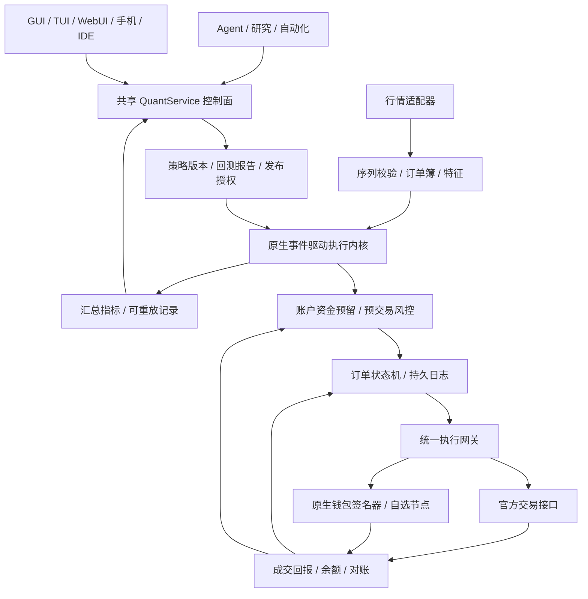

# CIBYP 高频量化交易套件规划

当前开发实现与限制见[原生钱包与量化工作台](quant-wallet-guide.md)。本文描述长期目标，不是已发布功能清单。

状态：评审草案 · 2026-10-25

基线：桌面仓库 `2fce058`；衔接[原生 Agent 钱包规划](agent-wallet-plan.md)。已开始分阶段实现；本文的完整目标仍未完成。实际接入、验收结果和差距见[实现进度](quant-implementation-status.md)。

## 1. 定位与范围

建设一套本地优先、可自托管的 **研究 → 数据回放 → 仿真 → 影子运行 → 实盘 → 复盘** 工作台。Agent 管研究、策略编写、测试、诊断和部署申请；原生事件驱动引擎负责连续行情、策略计算、风控和订单执行。

先按数字资产场景规划，兼顾原生钱包链上交易与用户自行配置的交易所账户。证券、期货及专线接入保留适配接口，按实际行情、账户和接入权限逐项实现。本文不指定用户开户场所，不提供收益承诺或资金配置建议。

延续钱包方向：链上交易由原生钱包签名、直接发往自选/自建节点；中心化交易场所是可选的官方 API 适配器，不经过托管交易机器人、聚合账户或第三方钱包中继。中心化场所中的余额仍受该场所的托管和规则约束，不能因此宣传整套交易流程已经去中心化。

### 产品档位

| 档位          | 目标场景                                          | 工程边界                                                            |
| ------------- | ------------------------------------------------- | ------------------------------------------------------------------- |
| 桌面量化      | 本机研究、回测、连续策略、API 自动交易            | GUI/TUI/WebUI 为控制界面，实际执行独立于窗口和聊天                  |
| 低时延执行    | 靠近交易场所的 Linux 主机、官方流式行情与订单接口 | 追求可测量的毫秒级内部处理；公网和交易所延迟另行测量                |
| 专业 HFT 接入 | 机房部署、直接行情、专线/原生协议、精确时钟       | 需要额外基础设施与市场接入，不能仅靠安装桌面 App 达成               |
| 链上交易      | AMM、链上订单簿及支持的链下签单协议               | 本地签单速度、提交、入块、成交、最终性分别统计；不套用 CEX 高频指标 |

专业接入可参考交易场所的 FIX/原生协议与共址服务，实际支持按场所验证。[Nasdaq Co-Location](https://classic.nasdaqtrader.com/Trader.aspx?id=colo)、[OUCH](https://classic.nasdaqtrader.com/Trader.aspx?id=ouch)。这些资料说明部署与连接条件的重要性，不构成本项目的延迟承诺。

## 2. 套件功能

| 模块       | 交付能力                                                               |
| ---------- | ---------------------------------------------------------------------- |
| 数据中心   | 实时行情、成交、L2/L3 能力检测、历史导入、质量检查、回放与存储管理     |
| 研究工作台 | Python/Notebook、因子与特征、参数实验、可复现实验记录、Agent 辅助分析  |
| 策略工坊   | 版本化策略、参数范围、编译/测试、仿真、对比、发布和回滚                |
| 回测实验室 | 事件回放、费用/滑点/延迟、队列与部分成交模型、样本外验证               |
| 执行中心   | 订单生命周期、限价/市价/条件单等能力检测、拆单、撤改单、成交回报与对账 |
| 风控中心   | 资金预留、仓位、敞口、费用、订单频率、行情有效性、暂停/撤单/应急处置   |
| 监控复盘   | 收益归因、成交质量、延迟分布、异常、策略/订单审计和可重放事故记录      |
| Agent 工具 | 查询、实验、策略草拟、仿真、部署申请、暂停、撤单与诊断                 |

初始研究模板可包含库存约束做市、价差/统计关系、趋势/均值回复、盘口特征，以及 TWAP/VWAP 等执行算法。它们是测试与研究样例，发布前须按目标市场完成数据、费用和执行验证，不标为开箱盈利策略。

## 3. 总体架构



- Node 共享后台负责服务生命周期、权限、设置、实验管理、Remote 与前端订阅。
- Rust 原生执行进程负责连续事件处理；LLM 调用、Python 分析、UI 渲染、日志格式化、压缩和大查询离开逐笔交易路径。
- 回测、仿真与实盘共享选定的策略/订单语义，通过时钟、数据源和执行适配器切换环境。
- 同一部署只启动一套执行内核，不因同时打开 GUI、TUI、WebUI 或手机而重复订阅、重复下单。
- 交易进程拥有明确生命周期；窗口关闭、模型切换、聊天清理和工作区重命名不隐式改变交易状态。

### 内核选型先做 PoC

先验证可否复用 NautilusTrader 的本地事件驱动核心与适配接口，并以 hftbacktest 校准回放/队列模型；P0 结束前选定一个生产核心，形成选型记录。

复用必须满足：单一订单/资金权威状态、可在网关前强制 CIBYP 权限、可控制队列和持久化失败、可复现策略时钟、所需平台可构建，以及许可证/分发要求可满足。不能因底层框架支持某交易所就绕过账户风控。若关键边界不可嵌入，改为范围收敛的自有 Rust 核心，不长期维护两套生产订单逻辑。

参考：[NautilusTrader 架构](https://nautilustrader.io/docs/latest/concepts/architecture/)、[hftbacktest 成交模型](https://hftbacktest.readthedocs.io/en/latest/order_fill.html)。参考与候选评估不表示这些依赖已经选定、接入或通过 CIBYP 验收。

## 4. 行情和研究数据

### 接入与质量

每个交易场所独立处理订阅、快照、增量序列、校验和、乱序、重复、心跳和恢复。TCP/WebSocket 连通不等于订单簿仍有效；发现缺口、无法衔接快照、陈旧报价或市场状态异常时，将相关数据标为不可交易，按策略配置停止新单并处理现有挂单。

保留交易场所时间、宿主接收时间、单调时钟、处理序列和来源；校时异常不能通过修改时钟后继续假装延迟正常。数据源切换需重新证明簿状态连续，不将两个场所或不同订阅层级直接拼成一份盘口。

场所数据语义以官方协议为准，例如 Coinbase 对逐产品序列缺口/乱序的说明，以及 Binance 的本地订单簿同步流程。[Coinbase WebSocket](https://docs.cdp.coinbase.com/exchange/websocket-feed/overview)、[Binance 行情规范](https://github.com/binance/binance-spot-api-docs/blob/master/web-socket-streams.md)。

### 存储与查询

- 原始行情采用分区、带 schema/version 的追加记录，异步归档至 Parquet 等格式；DuckDB 作为研究查询候选，不充当实时订单账本。
- 保存数据集版本、校验摘要、覆盖范围、缺失段、重建方式及交易场所/产品元数据版本。
- 策略实验固定数据集、代码、参数、随机种子、费用模型和依赖版本；不能让后续文件更新悄悄改变历史结果。
- LLM 默认读取统计摘要、异常和指定窗口；提供字段选择、时间范围、偏移/条数及文件导出，避免把逐笔流直接塞入上下文。
- 原始数据保留期、磁盘配额和实验引用分别管理；被实验引用的数据不直接清理。磁盘写满、记录不完整和静默丢失必须可见。
- 行情接入与历史数据获取按用户实际拥有的接口/数据权限配置，界面标明数据来源和可回放精度。

价格、数量、费用和合约乘数使用定点/整数表示，校验 tick size、lot size、最小名义额与当前产品规格。稳定标识包含场所、市场类型、产品及合约身份，不仅是 `BTCUSD` 等显示简称。

## 5. 策略开发与运行环境

研究层支持 Python；连续运行优先采用声明式策略或受限 WASM 模块，允许的宿主调用只产生订单意图，不能直接取得密钥、打开交易连接或写资金账本。

执行模块设置 CPU/内存/事件队列上限、错误处理和可终止机制；WASM 的 fuel/中断机制须在 PoC 中测量性能和确定性，不把沙箱当成无限资源保险。[Wasmtime 中断机制](https://docs.wasmtime.dev/examples-interrupting-wasm.html)。

策略发布物包含代码/编译产物哈希、参数及可调整范围、使用的产品和市场、依赖、所需能力、回测/仿真报告及负责人。Agent 可提交变更和在已授权范围内调参；扩大额度、增加账户、启用杠杆、修改执行权限或换代码版本均进入新发布流程。

先支持无需每笔远程模型推理的确定性策略。新闻、自然语言判断和较重预测模型异步生成带来源/可用时间的信号；过期、缺失或模型不可用时按策略定义降级，不等待聊天循环来决定下一笔订单。

## 6. 回测、仿真和实盘隔离

| 环境           | 数据与执行                                | 资金权限                         |
| -------------- | ----------------------------------------- | -------------------------------- |
| 历史回放       | 固定历史事件与模拟执行                    | 无实盘凭据                       |
| 实时仿真 Paper | 实时行情、虚拟资金与模拟成交              | 不向交易场所发送真实订单         |
| 影子 Shadow    | 记录真实时点下的信号/拟单，与市场结果比较 | 不实际下单，不能把拟单显示成成交 |
| Testnet        | 测试场所/本地链的真实接口调用             | 独立测试账户、端点和密钥         |
| Live           | 实盘行情、签名与真实执行                  | 有期限、范围固定的执行授权       |

模式在执行网关中强校验，不能只靠界面颜色或一个可被策略改动的布尔值。Paper/回放进程不持有实盘密钥；测试失败也不自动切换到生产端点。

高频回测至少建模：买卖价差、maker/taker 费用及返佣、部分成交、队列位置、订单到达/撤单延迟、拒单、频率限制、库存、资金费/借贷（适用时）和市场冲击假设。K 线可用于初步研究，但不能据此宣称证明了盘口高频策略。

只有 L2 数据时，队列位置是模型估计；回放不能真实改变未来历史盘口。报告必须公开成交和冲击假设，并用多个情景和仿真结果校准，不能把“触价”直接当作可无限量成交。此限制也见 [hftbacktest 官方说明](https://hftbacktest.readthedocs.io/en/latest/order_fill.html)。

研究记录保留样本内/样本外、滚动验证、数据实际可用时间、参数搜索次数和选择过程；针对重叠标签等情况选择适合的隔离窗口。区分毛收益、扣费后收益、回撤、敞口、换手、容量、成交率与成交质量；收益/夏普不是单独的自动上线条件。

## 7. 订单生命周期与恢复

```text
proposed → risk_checked → journaled → submitting
         → accepted → partially_filled → filled
分支：rejected / expired / pending_cancel / pending_replace / cancelled
未知：submit_unknown / cancel_unknown / reconcile_required
链上补充：signed / broadcast_unknown / included / finalized / reorged
```

订单、改单、撤单是分别有状态的请求；撤单与成交可能竞争，“收到撤单请求”不等于未成交。成交早于 ACK、重复/乱序回报、部分成交后重连和场所主动撤单都需要测试。

所有请求绑定持久的账户/策略/部署身份、客户端订单标识、命令版本与关联 ID。客户端标识是否唯一、保留多久、能否查询，由适配器验证，不能默认交易所替本系统保证永久幂等。

**超时后进入对账，不直接下第二笔。** 某些官方 API 明确指出超时不代表撮合失败，应结合用户数据流及订单查询确认。[Binance 官方 FIX 超时语义](https://github.com/binance/binance-spot-api-docs/blob/master/fix-api.md)。

场所成交回报/Drop Copy（可用时）与定期账户对账共同恢复权威状态；本地“已发送”不当作“已接单”，“已接单”不当作“已成交”。重复成交按场所身份去重，并支持更正、成交撤销及链重组等适用事件。

订单意图和恢复所需记录默认在发出前持久化，成交/余额变化可靠写入专用 WAL/事件账本。日志持久化的延迟计入性能测量；如未来增加更激进的异步持久化档位，须单独说明丢失窗口、恢复条件和账户风险，不悄悄改变默认保证。

重启后先查询挂单、成交、余额和未知操作，重建资金预留，再决定是否恢复策略。未知订单仍占用保守风险额度，不因缓存过期、聊天删除或进程重启而释放。

## 8. 风控与资金协调

### 逐笔风控

至少包括账户/策略/产品权限、可用资金、未成交订单占用、仓位/净敞口/总敞口、单笔数量与名义额、价格偏离、费用预算、订单/撤改单频率、数据时效、产品交易状态，以及适用的杠杆、保证金和 reduce-only 语义。

全账户共享场所限流器，保留撤单和恢复查询的资源。限流不能只按每个策略计算；手工订单和其他客户端的活动也要通过对账纳入状态。场所支持的 STP、post-only、IOC/FOK、deadline、reduce-only 和断线保护列入能力矩阵，缺少能力时明确降级/拒绝对应策略，不伪装原生支持。

这些功能的具体语义并不统一。例如 Kraken 的订单参数包含 deadline 与 STP 选项，应按对应官方接口实现。[Kraken Add Order](https://docs.kraken.com/exchange/api-reference/spot-websocket-v2/add_order)。

### 跨策略、钱包和账户

同一资金资源只有一个权威预留方。衔接钱包规划中的预算服务，给部署分配有上限的执行额度；引擎在该子额度内原子管理订单预留，不每个 tick 回到聊天审批。

钱包预算服务与订单引擎若分进程/数据库，使用持久租约、outbox 和去重回执；不能把两次独立写入称为原子事务。额度返还须先对账未成交、未知订单及尚可行使的签名授权。

跨场所操作单列单腿成交、对冲失败、余额不齐、传输/提现限制及资金闲置风险；两条腿不视为原子成交。借贷、杠杆和衍生品在独立阶段实现和验收，不能复用现货余额公式冒充完整保证金风控。

### 暂停、撤单与应急

界面区分“停止产生新订单”“撤销本策略挂单”“按事先授权处置仓位”。暂停不宣称资金已平仓；应急平仓也须约束范围与滑点，无法保证极端行情中的最终损失不超过阈值。

支持交易场所实际提供的断线撤单/Dead Man's Switch；续约依赖执行进程、行情和风控健康状态，而不是仅后台还活着。确认撤单作用域，避免取消不属于该策略的订单；作用域仅账户级的场所优先使用独立子账户。参考 [Kraken 断线保护说明](https://docs-legacy.kraken.com/api/docs/websocket-v1/cancelallordersafter/)。

租约到期和策略撤权应停止新增风险，但保留授权范围内的撤单、对账和风险处置能力。所有暂停/应急动作显示请求中、场所确认、失败/未知等实际状态。

## 9. Agent 工具与上线授权

按需加载量化工具；不把交易所接口全集、逐笔行情和 API 密钥注入提示词。

| 工具草案                                       | 用途                                                   |
| ---------------------------------------------- | ------------------------------------------------------ |
| `quant_listCapabilities`                       | 列出账户、场所、产品、数据及执行能力                   |
| `quant_queryData`                              | 查询获准数据集/时间窗口，返回分页与文件引用            |
| `quant_createExperiment` / `quant_runBacktest` | 创建可复现实验和回测任务                               |
| `quant_compareRuns` / `quant_getReport`        | 对比结果、成交假设、费用和异常                         |
| `quant_startPaper` / `quant_startShadow`       | 启动不产生实盘订单的验证                               |
| `quant_proposeDeployment`                      | 固定策略产物、参数、账户、额度和运行环境，提出上线方案 |
| `quant_requestLive`                            | 请求人类授权或使用既有、准确匹配的执行租约             |
| `quant_getStatus` / `quant_getOrders`          | 查询汇总、订单和风险状态                               |
| `quant_pause` / `quant_cancelOwnedOrders`      | 按实际权限暂停和撤销所属订单                           |
| `quant_proposeRiskChange`                      | 草拟风控变更；扩大权限需重新授权                       |

实盘授权绑定部署哈希、策略/参数范围、账户、产品、金额/敞口/费用、频率、有效期及撤单范围。用户一次授权允许范围内的连续执行；LLM 不对每笔订单做自由文本判断。

钱包/交易凭据由专用进程与受保护存储持有，研究环境和策略插件无权读取；API 能力优先使用账户实际支持的只读/交易权限分离，提现、内部划转、借贷等额外能力不自动附带。账户登录密码、签名密钥不经普通工具参数传递。

普通自动化、子 Agent 消息、设置助手和通用 AUTO_APPROVE 不能授予实盘资金权限。高权限宿主 Shell 的隔离边界沿用钱包规划中的明确限制，不把同用户加密存储描述成能抵抗所有宿主代码。

## 10. 时延、吞吐与网络

### 测量口径

记录接收、校验、特征/策略、风控、持久化、签名、socket 发出、场所 ACK、成交/链上确认等时间点。报告 p50/p95/p99/p99.9/max、丢包/缺口、队列深度、重连、拒单和资源占用，区分冷启动、稳定负载和突发。

首个工程基准可暂定：独立 Linux 参考机、单场所 10 个产品、每秒 1 万条混合回放事件，约 1% 事件产生新单/改单/撤单命令，接入本地仿真网关并稳定运行 1 小时；对产生命令的事件，内部“接收 → 校验/策略/风控 → 必要持久化/签名 → 写 socket”以 p99 不超过 5ms 为待验证目标。固定机器、策略、订单比例、记录大小和突发分布并公开结果；这不是当前性能事实或公网成交 SLA。压力基准不发真实订单，真实场所始终按其限流执行。

不得靠移除持久化、只报平均值、忽略签名/IPC/排队成本或静默丢数据取得漂亮数字。专业 HFT 的微秒级目标另立基准、基础设施和接入验收。

增加持续运行、突发及故障混合的专用长测；共享 CI 跑正确性和短基准，正式性能结论来自记录了硬件、系统、时钟、网络与存储条件的参考机器，不能把云端一次跑分当成部署保证。

### 运行设计

- 有界队列、按账户/产品划分状态所有权、预分配和批处理，测量后再选择具体优化；不笼统宣传“全程无锁”。
- 市场数据过载必须显式失效/重同步；成交与订单事件不静默丢弃。前端慢订阅可合并显示事件，不能拖慢订单处理。
- Python、LLM、图表、指标压缩、备份和历史查询分别设资源预算。固定版本的轻量预测推理可作为策略模块，但同样受执行时限约束。
- Windows/macOS 支持研发和正常自动交易；Linux 主机作为低时延基准。VM、共享云主机和 SBC 的调度/存储差异单独披露，Mini 可远程控制引擎，不等于 MCU 可承担高频执行。

### 继承已有网络安全设置

新 Rust 进程、WebSocket、FIX/TCP/TLS 不能假设会自动经过当前 Node fetch 代理。规划专用 TransportPolicy，把代理、Tor、TLS/CA 撤销、DNS、连接期限和端点身份一致传入并执行。

默认尊重用户的隐私设置；不为追求时延偷偷直连。若用户选择独立低时延连接策略，须显式配置并显示真实出口与适用范围。某传输无法满足已选择的隐私策略时拒绝该连接；不做自动换 IP/规避场所封锁。Tor 路径不承诺低时延。

## 11. 前端与部署体验

专业 UI 增加“量化”工作区：行情/盘口、策略与部署、订单、仓位、风险、实验和回测报告。青春 UI 保留简化入口。所有状态来自同一 QuantService，使用一致的账户和策略选择器，不让用户记内部 ID。

图表默认汇总订阅，可调节本机和远程刷新预算；订单/风险状态准确优先，原始行情按需打开。手机侧重监控、暂停和授权；Wear OS 展示有限摘要与提醒，完整资金变更转到手机。所有前端共用设置项目、主题/i18n 和动画开关。

TUI 入口为 `/quant`，提供实验、仿真、策略、账户、实盘授权队列和应急操作的菜单。GUI 关闭后是否继续执行由明确运行策略决定，托盘/后台状态持续显示实盘任务。聊天结束不等于交易结束。

更新流程增加执行状态检查：可先下载新版，安装/重启在暂停新增风险、撤单/对账及状态持久化后进行。进程异常重启先进入恢复状态，不立即重复运行策略；不同版本前端/内核的能力与协议兼容性明确握手。

## 12. 与现有项目的接入

| 当前基础                                                            | 规划接法                                                                         |
| ------------------------------------------------------------------- | -------------------------------------------------------------------------------- |
| `docs/agent-wallet-plan.md`                                         | 原生签名与链上预算的前置依赖；钱包未完成前，链上实盘能力保持未实现状态           |
| `src/main/automation/automation-manager.js` 与 `docs/automation.md` | 分钟级触发与 Agent 投递用于研究/任务编排，交易事件循环由原生内核拥有             |
| `src/main/services/runtime-tools.js`                                | 复用动态工具发现思想，增加 quant 分类，不把量化工具伪装成硬件工具                |
| `src/main/agent-runtime.js`                                         | 接入实验任务与专属资金授权，不使用通用自动批准生成实盘租约                       |
| `packages/remote/src/store.js`                                      | 普通缓存/去重不作为订单与成交账本，交易记录独立持久化                            |
| `src/main/services/remote-control.js`                               | 规范 Quant DTO、事件订阅、控制权限与限流；扩展规范先在 CIBYP-Remote 来源仓库完成 |
| `src/main/net-proxy.js` 及安全维护                                  | 新原生连接显式继承代理/隐私/信任库策略，验证不出现执行进程旁路                   |

建议先在当前仓库建立 `packages/quant/`（契约与 SDK）、`native/quant-engine/`（内核/网关）、`src/main/services/quant/`（编排），复用现有前端与钱包模块。市场数据、策略产物、实验记录和资金账本各有独立存储根，均不依赖可自动清理的聊天目录。

待核心契约和分发稳定后，再评估独立的无头执行器发布；不先开长期平行分支，也不要求接入第三方量化云。

## 13. 分期交付

| 阶段                   | 范围                                                              | 验收出口                                                            |
| ---------------------- | ----------------------------------------------------------------- | ------------------------------------------------------------------- |
| P0：选型与契约         | 内核 PoC、数据/订单/风险契约、持久化/秘密/网络边界                | 选定一个生产内核；证明订单可受控、状态可恢复，完成基准定义          |
| P1：研究与回放         | 数据导入、事件回放、策略工坊、报告、真实费用和成交假设            | 同一版本输入可复现；能显示缺失数据、队列/冲击模型限制及样本外结果   |
| P2：完整仿真闭环       | 一家用户可用的官方测试接口、实时 Paper/Shadow/Testnet、订单与风险 | 真实接口的断线/超时/部分成交/撤单竞争通过；全前端不会重复下单       |
| P3：受限实盘与钱包     | 专属授权、原生钱包测试链闭环、资金预留、对账、低时延优化          | 钱包前置能力通过；执行租约与 kill/cancel 语义成立；实测满足选定基准 |
| P4：扩展市场与高级执行 | 更多场所、协议、衍生品、跨场所策略、专线/原生接入                 | 每个适配器独立验收产品规则、资金/费用、恢复及性能；公布真实兼容矩阵 |

实盘验证须在用户提供实际场所/账户范围与执行授权后进行；本规划阶段不创建账户、不取得密钥、不发订单。默认首次进入 Paper，场所配置和网络连接都不自动把策略升级为 Live。

建议默认项：不自动启动实盘；现货范围优先，杠杆/借贷/提现不随交易权限开启；Live 授权有明确有效期；重启先对账；更新先下载、待执行状态允许后安装；资金操作与普通聊天自动批准分离。用户可在明确账户、额度和运行期限后启用连续自主交易。

### 发布前重点用例

1. 行情缺口、乱序、快照衔接、错误产品规格、时间漂移、市场暂停、爆量和存储写满。
2. 请求已经到达场所但 ACK 丢失、成交先于 ACK、重复成交、部分成交后断线、撤改单竞争、外部手工交易与引擎重启。
3. 多策略/多前端争用资金、租约过期、子 Agent 扩权、参数/代码被替换、普通自动批准绕过和秘密泄漏。
4. 所有签名/发送/回报持久化边界的故障注入；恢复后持仓/余额/挂单能对账，未知操作不被重新当成可用资金。
5. Paper 无实盘出口；断线保护作用域、应急撤单资源、暂停与实际订单状态一致；退出 GUI 和安装更新不会静默遗留不受控执行。
6. 回测成交假设、费用/资金费、容量、前视偏差、参数搜索和样本外结果可检查；模拟表现不能替代实盘执行质量证据。
7. 基准负载、突发、完整时延分位数、资源使用与无静默丢事件记录；Node/Rust/前端并发时的退化和网络隐私策略通过。
