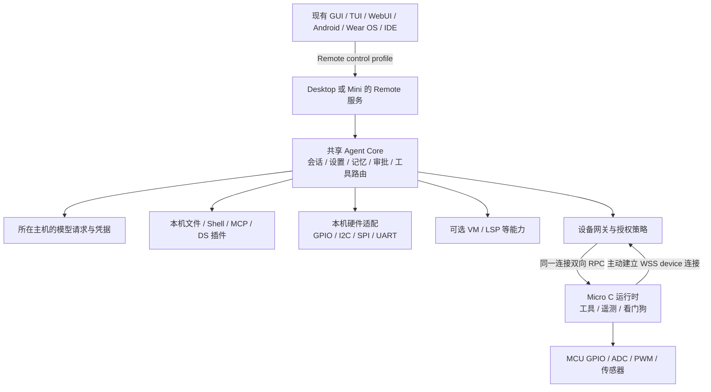

# CIBYP Remote、Mini 与 Micro 规划书

状态：评审草案 v0.1 · 2026-10-12

依据：桌面仓库 `943a868` 及当前工作区；已发布的 CIBYP IDE Remote v1 客户端。
本文保留评审时的架构与阶段规划。用户已批准实施；实际模块、测试和硬件验证边界见 [实施记录](remote-mini-micro-implementation.md)，不要将下面的全部规划项视为已验收。

## 1. 建议先确定的方向

**推荐独立仓库，不用长期产品分支：统一 Remote 协议，Mini 复用桌面 Agent 内核，Micro 使用 C 实现设备侧能力。**

建议形成三个新 public repo：`CIBYP-Remote`、`CIBYP-Mini`、`CIBYP-Micro`。桌面、IDE、手机和手表保持各自现有仓库；每个仓库内部用短期功能分支推进。Remote 仓库提供协议、SDK 和一致性测试；Mini 与桌面共用一份 Agent 业务实现；Micro 按受限设备协议接入同一体系。

| 产品 | 定位 | 主要运行位置 | 如何使用 |
| --- | --- | --- | --- |
| CIBYP Desktop | 完整桌面产品与后台 | PC、工作站 | GUI / TUI / WebUI / 原生客户端 / IDE |
| CIBYP Mini | **Node.js 无头 Agent 后台**，可以独立运行 | SBC、NAS、家庭服务器、无桌面 Linux | 现有前端通过 Remote 连接 |
| CIBYP Micro | **C 设备代理与硬件工具运行时**；精简独立 Agent 为后续可选方向 | MCU、嵌入式控制板 | 经 Desktop / Mini 网关远程控制 |
| CIBYP Remote | 上述产品共同遵循的协议与开发套件 | 开发依赖 | 不单独启动一套 Agent |

Mini 的“无前端”指核心安装包不携带 Electron、GUI、聊天 TUI 或 WebUI 静态页面，保留安装、诊断与服务管理 CLI。需要浏览器界面时，可以另行部署**现有同一份 WebUI 前端产物**，连接 Mini，继续保持一次前端开发。

Micro 的首发定位需要明确：它能在线接收工具任务、执行 GPIO / 传感器等扩展、报告结果；聊天、记忆、模型路由和审批由网关承载。若目标包含“MCU 自己直接调用云模型、没有 Mini / Desktop 也能聊天”，应作为 **Micro Agent 配置档**单独实现和验收，不能把设备代理宣传成完整 Agent。第 8 节给出该方向的取舍。

## 2. 现状检查与必须先拆的耦合

已有基础足以演进，不需要重新发明一套远程产品。当前已有 HTTP RPC、WebSocket 事件、密码与可选 TOTP、共享会话、请求去重、事件重放、附件，以及 Tor 远程接入。

| 检查位置 | 当前实际情况 | 对本规划的影响 |
| --- | --- | --- |
| `src/main/core/backend-server.js` | `/api/health` 报告 protocol 1；RPC 是 `{id,method,args}`；事件带 `sequence` | 保留 v1 适配器，新增有正式契约的 v2 |
| 同上 | 请求结果在内存去重；最多 64 个待处理请求；已完成记录按 512 条 / 10 分钟清理 | 不能直接用来保证硬件动作在重启后不会重复 |
| 同上 | 事件重放缓冲受 2048 条 / 4 MiB 限制；慢连接会被关闭以便刷新 | 已有背压基础，仍需事件分类、按需订阅和重启标识 |
| `src/main/core/backend-dispatch.js` | 通过读取 preload 源码、正则提取 IPC 通道来生成能力白名单 | Remote 不应以 Electron preload 为协议来源 |
| `src/main/agent-runtime.js`、`src/agent/index.js` | 已能无浏览器窗口运行，但仍需要 `ipcMain`；内核从 renderer 文件加载并补全全局变量 | “无窗口”尚不等于“纯 Node 可部署”；先做依赖倒置和显式模块导出 |
| `backend-dispatch.js` 的 `snapshot` 与 runtime 的 `getView` | 快照包含各会话内部 view；内部 view 有 `llmOverride` 等运行配置 | 必须在服务端定义公开 DTO 和权限投影，不能仅靠客户端删字段 |
| `src/shared/backend-client.js` 与 IDE TS / Java 客户端 | 多份请求、重连、序号处理逻辑 | 共用契约、样例和一致性测试，JS 客户端进一步共用 SDK |
| `src/shared/wire-values.js` | 二进制以 `$cibypBinary` Base64 包装，单次有较大字节上限 | 适合兼容现有功能，不应成为 MCU 默认传输方式 |
| `src/main/core/remote-backend.js` | 部分远程能力仍通过通用 `ipc:invoke` / `ipc:send` 转发 | 逐项改成明确的服务接口，桌面窗口操作留在客户端 |
| `src/main/services/backend-transport.js` | 同时服务自动化、DS 插件和子 Agent 通信 | 这是内部业务桥，名称相似但职责不同，不能直接当成网络协议模块搬走 |

第一批重构优先级：**服务端脱敏与授权 → 能力注册表 → 稳定协议 → 纯 Node 服务端口 → 硬件扩展**。Mini 不应依靠大量 Electron 假对象启动，Micro 不应接收任意 IPC 通道名。

## 3. 仓库与代码归属

### 3.1 为什么推荐新仓库

| 方案 | 优点 | 主要代价 | 建议 |
| --- | --- | --- | --- |
| 桌面仓库长期 `mini` / `micro` 分支 | 起步快 | Agent 修复容易分叉；C / Node 构建和发布互相拖累；协议变更难同步 | 不采用 |
| 所有产品放桌面 monorepo | 原子修改方便 | MCU 开发需要面对大量桌面依赖与资源，CI 和发布范围过大 | 只用于初期提取共享内核 |
| 协议、Mini、Micro 独立仓库 | 边界清楚；板级 CI、安装和版本可以独立推进 | 需要协议兼容矩阵和共享内核产物 | **推荐** |

### 3.2 拟议目录

```text
CIBYP-Remote/                   # 规范的唯一来源
  spec/                         # 生命周期、权限、错误、事件、兼容策略
  schemas/                      # 消息、服务 DTO、工具清单
  profiles/                     # control、device、可选功能配置档
  sdk/js/                       # Node / 浏览器共用客户端与协议基础
  conformance/                  # 金样报文、异常报文、跨语言测试
  examples/                     # 最小服务端、客户端、设备模拟器

Could-I-Be-Your-Partner/         # 现有桌面仓库
  packages/core/                # 拟提取：Agent、会话、设置、存储、工具路由
  packages/host-node/           # 拟提取：通用 Node 文件、网络、进程等适配
  src/main/adapters/electron/   # 拟归拢：窗口、托盘、桌面设备等
  src/main/adapters/vm/         # 拟归拢：可选 VM 能力

CIBYP-Mini/
  src/                         # 服务入口、配置、生命周期、诊断
  tools/                       # Node 定制工具与板级配置
  native/gpio-host/             # 可选 libgpiod 小助手
  packaging/                   # systemd、容器、安装与更新

CIBYP-Micro/
  core/                        # 可移植 C11 协议、调度、工具注册
  ports/esp-idf/                # 首个网络 / TLS / 存储 / RTOS 适配
  ports/host/                   # 桌面模拟与 Sanitizer 测试
  boards/                      # 引脚映射、能力、允许范围、启动状态
  tools/                       # GPIO、ADC、板载传感器等
  examples/                    # LED、按钮、温湿度、网关连接
```

模块不等于必须发布一个 npm 包。初期 Remote SDK 和共享内核可使用 GitHub Release 中**固定版本、带 SHA-256 与来源信息**的依赖产物；CI 校验后解包并构建。Mini 不能从桌面安装目录临时抓文件，也不能把复制的 Agent 源码另养一份。桌面仓库负责产出内核，Mini 锁定其版本；桌面 CI 同时运行 Node 导入和 Mini 冒烟测试。

先在桌面仓库用 `codex/remote-contract`、`codex/core-host-ports` 等短期分支完成提取，再建立对应产品仓库。共享协议通过兼容矩阵协调发布，产品版本可以独立；继续沿用现有许可与版权声明，第三方驱动逐项记录来源。

## 4. 目标架构与运行角色



三个角色应分开协商：

1. **Controller**：展示会话、发送消息、应答审批的前端。
2. **Agent host / Gateway**：Desktop 或 Mini，持有 Agent、模型凭据、持久化数据和设备授权。
3. **Device node**：Micro，持有本设备身份及有限硬件能力，不自动获得聊天记录、模型密钥或其他设备权限。

Micro 主动连接网关，适合没有入站端口的局域网设备。首期一个设备只接受一个已配对网关持有控制权；多人和多个前端通过该网关协作。跨网关迁移必须解除或转移绑定，不能让两个后台同时控制输出。

Mini 也可配置为“仅设备网关”：不启动 Agent / 模型适配，只负责聚合设备工具，再供 Desktop 调用。其与独立 Agent 模式共用代码和协议，通过能力配置启用。

同一实例目录只允许一个后台写入。Desktop 与 Mini 在同一台主机安装时，先发现并连接已有实例；若所需能力不兼容，明确提示迁移或使用独立实例，不能两个进程同时打开同一数据目录。不同机器的实例具有独立 `instanceId`；连接多个目标不意味着自动复制所有记忆、聊天和模型凭据。

延续现有 VM 原则：LLM、VLM、生图、System One 请求在 **Agent 所在主机**发起。Mini 独立运行时主机就是 SBC；VM 和首期 Micro 只执行被分配的工具。

## 5. Remote v2 协议规范

### 5.1 契约与传输分层

建议 v2 使用 **JSON-RPC 2.0 + UTF-8 JSON** 定义请求与结果，HTTP / WebSocket 承载。标准的请求 ID、命名参数、错误对象和通知语义可以减少自定义规则；副作用调用必须带 ID，不使用无需响应的通知执行硬件动作。[JSON-RPC 官方规范](https://www.jsonrpc.org/specification)

这里的“Remote 协议主版本 2”与 JSON-RPC 的 `jsonrpc: "2.0"` 是两个概念。JSON-RPC 不提供认证、持久化、重放或硬件幂等，这些由以下 CIBYP 契约补齐。

| 层 | 责任 |
| --- | --- |
| 数据契约 | 类型、必填项、大小限制、错误码、消息语义 |
| 服务层 | session、task、interaction、settings、tool、device、update |
| 身份与策略 | 用户 / 客户端 / 设备身份、权限、审批、审计 |
| 传输适配 | HTTP、WebSocket；浏览器 cookie；原生认证头 |
| 可选通道 | Tor / SSH / TLS 反向代理；复用同一业务协议 |

首期不同时增加 MQTT、自定义二进制 RPC、gRPC 和另一套消息队列。未来若 MCU 实测需要 CBOR，可增加协商后的编码配置档，服务语义与测试向量保持一致。

拟议 v2 端点边界：

| 端点 | 用途 |
| --- | --- |
| `/remote/v2/auth/*` | 登录、登出、令牌 / 设备身份管理；配对入口单独限流 |
| `/remote/v2/rpc` | Controller 调用 HTTP JSON-RPC 服务 |
| `/remote/v2/events` | 已认证 Controller 的 WebSocket 事件订阅 |
| `/remote/v2/devices` | Micro 主动建立的已认证双向 WebSocket RPC；不接受普通用户令牌冒充设备 |
| `/remote/v2/blobs/*` | 经授权的附件 / 更新二进制传输；限制来源与重定向 |

设备通道上的请求 / 结果仍遵循同一 JSON-RPC 契约，但仅开放 device profile 的方法。所有远程前端通过 Controller 通道使用网关，不直接绕过网关向 MCU 提交用户审批。

### 5.2 发现、握手与能力

- `GET /.well-known/cibyp-remote`：只暴露服务标识、支持的协议主版本和认证方式，不暴露会话、路径、PID、onion 密钥或设备清单。
- 认证后 `system.hello`：返回 `instanceId`、`bootId`、产品版本、协议 minor、profile、授予的权限和能力，以及报文 / 并发 / 缓冲上限。
- 本地发现继续支持现有用户目录 / 临时文件方案；新版文件列出 `protocols`，保留旧 `protocol:1` 字段兼容现有启动器和 IDE。
- 能力是实际可用功能，例如 `session.chat`、`session.code`、`hardware.gpio`、`vm.exec`、`desktop.window`、`attachment.transfer`。没有能力的控件由前端禁用或隐藏，并提供本地化原因。
- 产品版本、协议版本、工具版本和固件版本独立。能力缺失返回 `CAPABILITY_UNAVAILABLE`，不能返回空成功。

拟议握手结果示例：

```json
{
  "jsonrpc": "2.0",
  "id": "hello-01",
  "result": {
    "protocol": {"major": 2, "minor": 0},
    "instanceId": "host-7c92",
    "bootId": "boot-410a",
    "product": {"name": "CIBYP Mini", "version": "0.1.0-alpha.1"},
    "profile": "control",
    "capabilities": ["session.chat", "session.code", "tools", "devices"],
    "limits": {"maxMessageBytes": 262144, "maxInFlight": 8}
  }
}
```

JSON Schema 是服务 DTO 的事实来源；据此生成 TS 类型、文档、金样报文与 C 结构 / 校验代码。MCU 不携带通用 JSON Schema 解释器。参数未知字段、长度、数值范围、UTF-8、嵌套深度都必须明确；未来可选响应字段允许旧客户端忽略，不能改变现有字段含义。

### 5.3 服务接口

| 服务命名空间 | 主要方法 / 行为 |
| --- | --- |
| `system.*` | hello、health、启动进度、状态、诊断 |
| `session.*` | list、create、get、submit、stop、undo、history；服务端负责会话串行与并发规则 |
| `interaction.*` | list、answer；问题和审批有独立 `interactionId`、有效期和 revision |
| `settings.*` | catalog、get、patch；带 revision，支持字段权限和脱敏 |
| `workspace.*` | 列目录、绑定、同步状态；用服务器 `workspaceId`，不混淆客户端本地路径 |
| `attachment.*` | 创建上传、完成校验、元数据、下载；正文保存 attachment ID |
| `tool.*` | list、describe、invoke、status、cancel；自定义与内置工具走同一入口 |
| `device.*` | 配对、列表、状态、权限、迁移、解绑；工具清单与硬件状态 |
| `events.*` | 按会话 / 设备 / 事件类型订阅，按游标恢复 |
| `update.*` | 检查、下载、校验、进度、请求安装；受产品能力与人工确认控制 |

大列表必须分页，会话快照只含必要元数据；当前会话的消息、附件、工具详情按需读取。模型上下文与用户聊天记录继续分离，协议不依靠内部工作消息重建聊天记录。文本、推理摘要、完整可见推理和附件使用明确 content part；加密推理只作为受权限控制的 opaque 数据保留 / 导出，不能当正文显示。

`settings.patch` 使用 `expectedRevision` 防止不同前端互相覆盖。隐私设置通过专门写入接口处理；普通配置读取返回是否已配置等信息，不能返回完整密钥。界面翻译由客户端共享词典完成，错误返回稳定 `reason` 与结构化参数，不能让 MCU 接收整份翻译包。

### 5.4 请求、任务、事件和重连

必须区分以下 ID：`requestId` 标识一次 RPC，`operationId` 标识可重查的业务动作，`turnId` 标识消息轮次，`interactionId` 标识一次问题 / 审批，`deviceId` 标识设备，`bootId` 标识一次启动，`streamId + sequence` 标识事件位置。ID 使用长度受限的字符串，避免 JS 与 C 对大整数处理不同。

- HTTP 提交任务后尽快返回任务 ID；人类审批、长工具调用和 LLM 运行不挂在一个 HTTP 请求上等待。
- 业务动作持久化受理结果；重试携带相同 `operationId`，同一 ID 换参数必须拒绝。重启后先查状态，不能对所有操作一律透明重试。
- 会话和设备写入有 revision；审批回答必须匹配 ID 和 revision，重复回答返回已有结果，过期审批不能作用到下一次同文案审批。
- 每条可恢复事件带 `streamId`、`sequence`、目标和 revision。重启、越界或过期游标返回 `RESYNC_REQUIRED`；客户端重新取快照并从新水位订阅，不能只比较一个重置为零的序号。
- 持久化任务终态、未决审批和关键动作审计；逐 token 文本可以合并，传感器遥测可按最新值合并。关键事件超出缓冲时明确要求重同步，不静默丢掉审批 / 完成状态。
- 连接采用有抖动的指数退避，支持心跳与显式离线。认证失效停止自动重连；网络中断与无权限使用不同错误。
- 网关转发 Micro 动作时附有效期限；设备按单调时钟检查接收后的剩余有效期，不要求 MCU 必须先拥有可信日历时间。

快照和事件要有一致水位：得到 snapshot revision / cursor 后订阅，期间的事件必须能重放。页面不能同时应用旧快照和新事件导致状态倒退。

### 5.5 错误、附件与资源限制

JSON-RPC `error.code` 使用稳定数值分类，`error.data` 至少包含 `reason`、`retryable`、可选 `retryAfterMs` / `operationId`。区分 `AUTH_REQUIRED`、`FORBIDDEN`、`REVISION_CONFLICT`、`DEVICE_OFFLINE`、`RESOURCE_BUSY`、`DEADLINE_EXCEEDED`、`RESULT_UNKNOWN`、`PAYLOAD_TOO_LARGE` 等原因，用户不必从 Node 堆栈猜状态。

| 配置档 | 初始预算草案 | 处理原则 |
| --- | --- | --- |
| Desktop / Mini control | 单个常规 RPC 最大 256 KiB；Mini 默认并行受理 8 个 | 消息、列表、工具结果分页；限制可配置但有上限 |
| Micro device | 单个 JSON 消息最大 4 KiB；默认 1 个执行中动作、有限事件槽 | 超限拒绝，使用固定缓冲，不分配无界大对象 |
| 附件 / 更新 / 固件 | 独立 HTTP 二进制流，分块、断点和哈希 | 不塞进 RPC 或遥测；Micro 首期只接专用固件流 |

上述数字是待实测冻结的设计预算，不代表已有性能保证。工具结果被预算限制时必须返回 `truncated`、总长度和继续读取游标；AI 与用户能够主动读取后续内容，不能把数据不可恢复地裁掉。MCU 工具以小结构结果为主，不模拟桌面大附件系统。

## 6. 认证、配对与 Remote 通道

前端用户、插件、Micro 设备是不同身份，不能共用一个万能令牌。最低权限至少分为查看会话、发送消息、审批、改设置、文件读写、执行工具、设备管理、安装更新；硬件权限继续细分到设备、资源和参数范围。

| 场景 | 建议方式 |
| --- | --- |
| 本机可信前端 | 受 OS 用户隔离的发现凭据；限制发现文件权限；新客户端换取有范围的会话 |
| 原生 / IDE 远程客户端 | HTTPS / WSS + 访问令牌；凭据存系统安全存储 |
| 浏览器 | 同源 HttpOnly cookie；Origin / CSRF 校验；WebSocket 复用认证会话 |
| Micro 首次绑定 | 可信本地 USB / 串口配置网关地址与身份，或设备进入限时配对状态后完成一次性配对 |
| Micro 正常连接 | 验证网关 TLS 身份；使用独立设备凭据，优先 mTLS；支持撤销 / 轮换 |
| Tor | Desktop / Mini 网关运行 Tor，客户端使用现有 Tor 能力；Micro 无需内置 Tor |
| SSH | 作为到本地 Remote 的可选隧道；协议和权限不随隧道改变 |

配对令牌必须限时、一次性，并绑定待配对设备身份。USB 建立的信任或独立显示 / 印刷的指纹用于确认网关；Wi-Fi 凭据和长期秘密不能明文广播。配对成功不等于授予所有引脚写权限。解绑撤销身份并释放租约，设备恢复为待配对 / 本地规则状态。

TLS 配置由适配层校验，不能假定 `wss://` 自动意味着正确验证服务器。ESP 官方 WebSocket 文档明确提示证书验证与配置有关，并提供 mTLS 接入方式，端口实现必须对缺失可信证书 / 错误主机名做失败测试。[ESP WebSocket Client](https://docs.espressif.com/projects/esp-protocols/esp_websocket_client/docs/latest/index.html)

Mini 的 Tor 为可选模块，需单独验证 Linux ARM64 的运行时与网桥传输可用性；不会为 MCU 增加 Tor、桥分发和穿透服务负担。网络可达性与用户身份认证分别处理；Tor 失败时不会自动改成公网明文暴露服务。

## 7. CIBYP Mini 设计

### 7.1 纯 Node 内核与宿主端口

把内核改为 `createCore(hostServices, options)`，内核通过明确接口使用以下能力：

| 端口 | 共享部分 | 宿主适配部分 |
| --- | --- | --- |
| Settings / Secrets | 配置目录、revision、迁移、脱敏规则 | OS 密钥存储或受权限保护的服务器秘密文件 |
| Sessions / Memory / Todos | 历史、模型上下文、自动记忆、Babe 关系、待办 | 路径、原子写入、备份 |
| ProviderTransport | API 格式、模型池、订阅授权、用量、重试 | 主机网络与代理，远程登录回调 |
| ToolExecutor | 注册、授权、结果、取消、审计 | Node、MCP、DS 插件、VM、硬件、Micro |
| Workspace / Process | 工作区绑定与任务语义 | 文件、Shell、PTY、LSP、VM 同步 |
| Platform / Notifications | 能力状态、启动事件、通知 | Desktop 窗口 / 托盘；Mini 日志和远程事件 |

不会另写第二套 Agent 循环、模型池、设置或记忆。所有现有模式使用共享实现；原生 `runSubAgent`、自动化、审批与问卷保持同一语义。DS 插件和 MCP 在能力允许时使用现有适配；依赖桌面窗口或本机二进制的平台插件明确标记不可用。

Mini 默认启用会话、设置、工作区、基本文件 / Shell 工具和 Remote 服务。VM、Code-OSS、浏览器自动化、OCR、语音、本地模型、大型插件和 Tor 均按需安装 / 加载。Code 模式可以工作在普通目录并调用可选 LSP，不要求安装完整编辑器。禁止把桌面安装脚本的资源下载步骤隐式带到 Mini。

### 7.2 支持矩阵与预算

建议首发 Linux ARM64 和 x64，使用 Node.js 24 LTS；Node 版本在安装 / 更新时单独检查，不强行覆盖用户的系统 Node。当前官方发布页将 24 / 22 列为 LTS、26 列为 Current，24 适合作为这一版基线。[Node.js 发布状态](https://nodejs.org/en/about/previous-releases)

32 位 ARMv7 作为后续实验平台；Node 24 已将其列为 Experimental，不能宣称所有树莓派和任意 32 位 SBC 开箱即用。依赖中的原生模块还需要额外验证。[Node v24 平台矩阵](https://github.com/nodejs/node/blob/v24.x/BUILDING.md)

- 开发参考机：64 位 Linux SBC，2 GiB RAM；1 GiB 档作为后续实测对象。
- 优化目标：纯净服务、未加载 VM / 本地模型 / 大型插件、一个空闲会话时 RSS ≤ 128 MiB；P2 测量后再决定正式最低配置。
- 默认限制：1 个运行中的 Agent 任务；设备数、上下文大小、日志和事件缓冲可配置且有硬上限。客户端连接不复制 Agent 内存。
- CI 至少覆盖 Linux x64、ARM64 Node 冒烟；GPIO 和功耗等结果需参考板实测。容器只作为可选部署，硬件设备访问要显式映射。

### 7.3 运行、安装与维护

拟提供 `cibyp-mini serve / status / doctor / pair / stop / update` 等服务 CLI，首次安装输出配对说明和启动进度。配置可由现有 GUI / 原生客户端远程完成；订阅登录需要浏览器时在客户端打开登录，不在 SBC 上偷偷启动图形环境。

systemd 服务支持自动重启、限速退避和可查询启动状态。远程登录和正常业务接口在设置、存储迁移和工具注册就绪后放行；初始化期间仅提供受限 health / boot 状态，启动失败有可读诊断。

状态目录、工作区、秘密和版本目录分离。更新先下载、校验签名 / 哈希与兼容性，再等待活动任务和硬件动作处理完毕；切换版本后自检，失败回退。所有前端调用同一 `update.*` 服务，安装与重启按设置和人工确认执行。镜像站只提供下载加速，可信清单与校验仍从独立可信来源获得。

## 8. CIBYP Micro 设计

### 8.1 首发范围

建议 **可移植 C11 核心 + ESP32-S3 / ESP-IDF 首个参考端口**。参考板优先有足够 Flash、可调试串口和网络；是否必须 PSRAM 用实际固件峰值决定，不先承诺最低 MCU 配置。ESP-IDF 已有 TLS 与 WebSocket 客户端基础，CIBYP 负责身份、任务和工具契约。[ESP-TLS](https://docs.espressif.com/projects/esp-idf/en/stable/esp32s3/api-reference/protocols/esp_tls.html)

| Micro 核心能力 | 首发内容 |
| --- | --- |
| 连接 | 主动 WSS 到已配对网关、认证、心跳、断线重连、可读错误 |
| 调度 | 单任务默认、有界排队、超时、可取消步骤、动作状态查询 |
| 工具 | C 函数静态注册；工具清单分页；GPIO 读写与简单传感器示例 |
| 遥测 | 在线、内存、固件版本、工具状态；按订阅采样并限制频率 |
| 状态 | 设备身份、板级配置、小型动作日志；不保存完整聊天 / 长期记忆 |
| 维护 | 看门狗、崩溃 / 重启原因、USB 诊断；后续签名应用 OTA |

C 核心提供网络收发、单调时钟、随机数、持久化、互斥 / 调度、硬件 HAL 等端口；ESP-IDF / RTOS 细节留在端口层。关键消息使用固定内存池和长度检查，网络回调只入队，耗时外设操作交给工作任务。需要支持 WebSocket 分片重组和严格总长度限制，不能假设每次回调都是完整 JSON。

预算草案：CIBYP 协议 / 调度新增 RAM ≤ 32 KiB、代码 Flash ≤ 128 KiB，**不含** RTOS、Wi-Fi、TLS、驱动及 OTA 槽。总 RAM、Flash、TLS 握手峰值必须按板子测量；不把该预算当作“32 KiB MCU 可运行网络版”的承诺。

第二端口优先选 Zephyr，以扩展不同厂商 MCU；Zephyr 有官方 WebSocket 客户端 API，但板级网络、TLS、存储仍逐项适配。[Zephyr WebSocket API](https://docs.zephyrproject.org/latest/services/connectivity/networking/api/websocket.html) 无网络的小 MCU 可后续通过 USB / UART 接网关，仍使用相同工具契约；不优先为首版自写 TLS 栈。

### 8.2 Micro 是否独立调用模型

| 配置档 | 能力与成本 | 建议 |
| --- | --- | --- |
| **Micro Device** | 网关运行 Agent；MCU 执行工具。资源、密钥、上下文和恢复逻辑最可控 | **首发基线** |
| Micro Agent | MCU HTTP 调用云模型，维护有界消息和少量工具循环；本地需要模型凭据、供应商协议适配和恢复策略 | 设备协议稳定后选一个 Provider 做试验 |
| 完整桌面等价 Agent | DS Node 插件、完整记忆、VM、编辑器、所有模型格式 | 不列入 MCU 产品兼容承诺 |

Micro Agent 若推进，应支持资源协商和远程聊天能力，仍复用 Remote 服务 DTO；AI 循环使用独立 C 实现，但通过共同的 Agent 行为用例验证。首先限制单会话、单 Provider、固定工具集合，完整历史存网关 / 客户端；这项会增加一套受限 Agent 实现的维护成本，需要作为明确的第二阶段产品决策。

### 8.3 固件与恢复

首发串口烧录；应用 OTA 放在连接、动作日志和恢复测试通过之后。OTA 使用签名固件、板型 / 版本校验、分块下载、完整性校验与启动自检。ESP-IDF 支持双应用槽与应用回滚；bootloader / 分区表更新有不同的断电风险，首期 OTA 只更新应用分区。[ESP-IDF OTA 与回滚](https://docs.espressif.com/projects/esp-idf/en/stable/esp32s3/api-reference/system/ota.html)

固件安装须人工确认，AI 只能查询或发起安装申请。Secure Boot / eFuse 等不可逆配置通过独立 provisioning 流程管理，不能由普通远程工具自动修改。设备恢复后不重放过期硬件动作，也不为逐 token / 高频遥测持续写 Flash。

自定义工具固件支持用户自己的构建与签名密钥，通过 provisioning 明确设置该设备信任的签名者；不会要求所有扩展只能由 B5-Software 签名。普通 OTA 请求不能自行增加新的受信任密钥。

## 9. 定制工具、GPIO 与外设扩展

### 9.1 统一工具清单

工具清单描述名称、版本、输入 / 输出 Schema、执行位置、所需能力、超时、输出上限、权限范围、资源冲突、幂等方式、取消支持和断连策略。工具描述是提供给模型的文本；**权限等级由网关管理员策略决定，不能信任插件自行声明“无副作用”。**

拟议工具清单片段：

```json
{
  "name": "hardware.gpio.write",
  "version": "1.0.0",
  "target": "device",
  "requires": ["hardware.gpio"],
  "inputSchema": {
    "type": "object",
    "properties": {
      "resource": {"type": "string", "maxLength": 64},
      "level": {"type": "integer", "enum": [0, 1]}
    },
    "required": ["resource", "level"],
    "additionalProperties": false
  },
  "execution": {
    "idempotency": "set-state",
    "requiresLease": true,
    "timeoutMs": 2000,
    "maxResultBytes": 512
  }
}
```

设备、lease、`operationId`、剩余有效期和允许的参数范围由网关执行上下文附加，不能全部交给模型随意生成。工具路由可以具体定位 `deviceId`，模型看到友好资源名，例如 `desk_status_led`，而不是让它猜物理引脚号。

Mini 扩展采用 Node 注册接口；资源较高或需要隔离的工具使用独立进程。Micro 扩展采用 C 注册表，例如 `cibyp_tool_register(&status_led_tool)`；默认编译期加入，不接受远程上传 C / JS 文本立即执行。工具安装 / 更换有独立管理权限与来源校验。

与 MCP 的关系：MCP 是外部工具生态入口，Remote 是 CIBYP 的会话 / 设备控制协议。Mini 可以把获准设备工具映射为 MCP tools，Micro 不必实现整套 MCP。映射可以复用 MCP 的 `inputSchema` / 结果结构，但 CIBYP 自己校验审批和权限，不把工具 annotations 当授权依据。[MCP Tools 规范](https://modelcontextprotocol.io/specification/2025-11-25/server/tools)

### 9.2 硬件接口路线

| 类别 | Mini / Linux | Micro |
| --- | --- | --- |
| GPIO | `/dev/gpiochip*` + libgpiod；板型映射 | HAL GPIO；禁止保留 / 启动引脚 |
| 按钮 / 输入事件 | 边沿订阅、去抖、限频 | 中断收集到有界队列，异步上报 |
| I2C / SPI | 受限设备地址与寄存器范围；优先现有内核驱动 | HAL 驱动 + 受限事务 |
| UART | 指定端口、波特率与数据上限 | 同样限定，避免占用调试 / provisioning 串口 |
| ADC / PWM | 按板子真实能力暴露；不会假设 SBC 自带 ADC | 单位、校准、占空比 / 频率边界 |
| 传感器 / 执行器 | 优先封装“读温度”“设置状态灯”等语义工具 | 同一语义契约、不同 HAL 实现 |

Linux GPIO 使用字符设备接口，避免新实现依赖已弃用 sysfs；对已有内核驱动的硬件优先调用对应子系统，不在用户态模拟总线时序。[Linux GPIO 字符设备 API](https://www.kernel.org/doc/html/latest/userspace-api/gpio/chardev.html)、[sysfs 弃用说明](https://www.kernel.org/doc/html/next/admin-guide/gpio/sysfs.html)

Mini 的 GPIO 可选助手使用 libgpiod，业务服务仍是 Node。助手持有 line request，支持读取、设置和租约；不能每次 `gpioset` 后立即退出导致输出保持语义失效。Linux line request 的申请 / 设置 / 释放生命周期按官方 API 实现。[libgpiod line request](https://libgpiod.readthedocs.io/en/master/core_line_request.html)

默认普通服务用户运行，只给明确设备文件权限。板级配置记录 chip / line、物理针脚映射、active-low、允许方向 / 范围、启动状态和断连行为；桌面授权界面展示设备与友好资源。不能把不同 SBC 的编号直接互换，也不能默认释放引脚就一定进入低电平。

工具清单带独立 revision，设备上下线、权限变化、固件变更触发目录热更新。模型默认只接收当前模式和目标获准使用的工具；大清单先查询、再按需描述，避免每次请求注入全部 GPIO / 外设定义。正在执行的任务绑定工具版本和权限快照，执行前仍检查授权是否被撤销。

### 9.3 动作可靠性与竞争控制

**网络确认、Flash 记录和物理动作之间不能普遍实现严格 exactly-once。** 因此必须区分“设置状态”与“执行一次事件”。

- 优先 `gpio.write(level=1)` / `pwm.set(duty=...)`；`toggle`、发脉冲、步进等非幂等动作要求 `operationId` 和明确的重复执行策略。
- 网关记录受理与结果；设备在有界日志中识别重复动作。若掉电发生在执行与结果持久化之间，返回 `RESULT_UNKNOWN` 并查询实际状态；无法查询的事件交给用户判断，不自动再做一次。
- 动作状态至少包含 queued、running、succeeded、failed、cancelled、expired、unknown。取消不等于已经发生的电气变化被撤回。
- 每个资源使用租约，携带单调递增的 fencing generation，设备拒绝旧租约和旧控制者。GPIO 助手退出 / 重启后重新申请资源并报告状态。
- 断连行为由板级资源配置确定：释放、保持或设为已配置状态；断电后的电平由电路与启动配置决定。紧急停止、本地看门狗和时序控制在设备端完成，不等待 Tor / LLM 往返。
- 连续执行的规则有采样频率、输出范围和时间上限。高频采样默认聚合，不给每个变化发一条聊天消息。

## 10. 对现有前端的影响

前端继续连接同一个后台实例，共享会话、设置、任务和待办。每个目标实例各自拥有数据和主题；切换目标时先清理上一目标的缓存、凭据上下文和操作权限。

| 前端 | 需要适配的主要内容 |
| --- | --- |
| GUI / WebUI | 实例能力、设备页、引脚授权、工具状态、明确的服务端工作区；Desktop 窗口行为保持本地 |
| TUI | 同一设备 / 工具列表、问卷 / 审批、离线与任务状态；能力不可用时给清楚提示 |
| Android / Wear OS | 复用目标主题 / 头像；增加设备状态和审批；合并刷新，避免 MCU 遥测或 token 流压垮手表 |
| VS Code / JetBrains | 替换公共协议契约；保留 IDE 原生 UI；可选设备工具视图；不复制 Agent |
| 自动化 / 子 Agent | 经过同一授权与工具路由；委派不能扩大父 Agent 的设备权限 |

设备配置和工具目录属于共享 settings catalog；不同前端展示同一配置含义。布局可遵守各平台设计语言，不能再长出另一份设置事实来源。

## 11. 迁移与实施顺序

依赖顺序：`P0 → P1 → P2 → P3 / P4 → P5`。P3 与 P4 均依赖已经可用的网关 / 工具契约，可以分别推进，最终共同验收。

| 阶段 | 工作与交付物 | 完成门槛 |
| --- | --- | --- |
| **P0：清点与契约** | 服务 / 事件 / 敏感字段清单；v1 金样；角色与权限表；Remote v2 草案和兼容矩阵 | 当前 GUI、TUI、WebUI、IDE、手机主要用例有可执行回归场景；没有业务行为变化 |
| **P1：Remote 模块化** | 显式能力注册；服务端公开 DTO；版本协商；v1 adapter；JS SDK；v2 控制端契约 | 服务端测试证明密钥不在普通读取响应；v1 客户端可继续连接；审批 / 重连 / 并发修改通过 |
| **P2：Node Core / Mini** | 内核端口提取；无 Electron 启动；Mini 服务、远程设置、存储、诊断和更新；ARM64 CI | 不安装 / 导入 Electron、不依赖 renderer 页面启动；真实模型 + 工具 + 审批 + 重启恢复可用 |
| **P3：Mini 硬件扩展** | 工具注册表；板级映射；libgpiod 助手；读输入、写 LED、权限与租约 | 模拟测试与参考 SBC 实测；重复请求 / 断线不会重复一次性动作；非法资源被拒绝 |
| **P4：Micro Device** | C 核心、host 模拟器、ESP-IDF 端口；配对、WSS、GPIO、遥测、有限日志 | 参考 MCU 实测连接 / 断线 / 网关重启 / 持续运行；内存峰值达预算；失去权限后停止新动作 |
| **P5：生态与发布** | 各前端设备入口；更新 / 回滚；完整安装说明、示例与能力兼容表 | 一套真实客户端到参考硬件的端到端演示；跨版本升级和回退通过 |
| P6：扩展项 | Zephyr / 串口节点、更多传感器、Micro Agent、设备组、可选编码 | 按需求和实测资源选择，不阻塞首发 |

v1 的 `/api/*` 保持现有报文结构；v2 使用独立 `/remote/v2/*` 入口。v1 适配器只能调用新服务层，不能继续保留第二套业务实现。老客户端经适配器也要获得经过权限投影的数据；确需旧 UI 的配置功能通过专门受控方法迁移。

v1 至少保留两个桌面稳定发布周期；最终截止点由客户端支持矩阵决定。不能以“客户端忽略错误”代替兼容，也不能让设备自动降级认证或忽略能力协商。

## 12. 测试与验收

| 测试类别 | 必测场景 |
| --- | --- |
| 协议一致性 | JS、Java / Kotlin、C 共用金样；未知字段、错误类型、中文、空值、越界、分片、畸形 JSON |
| 远程恢复 | 快照与订阅之间发生事件；缓冲过期；后台重启序号重置；令牌过期；重复 / 乱序事件 |
| 并发与授权 | 多前端设置冲突；同一个审批同时回答；设备解绑；插件越权；不同会话抢同一引脚 |
| 动作幂等 | 丢请求 / 丢确认 / 延迟确认；同 ID 换参数；执行中重启；动作过期；结果未知不自动补执行 |
| C 稳健性 | host 端 ASan / UBSan、解析器 fuzz、内存池耗尽、无终止字符串、长度溢出、队列拥塞 |
| 持久化 | 历史 / 上下文独立；写入中断；存储满；配置迁移失败；动作日志损坏；避免高频 Flash 写入 |
| 硬件实测 | 参考板输入 / 输出；进程退出后 line 状态；MCU 看门狗；断网 / 断电；板型不匹配 |
| 安装与更新 | Linux x64 / ARM64 干净环境；无桌面启动；镜像哈希不符；升级自检失败回退 |
| 兼容回归 | Chat / Code / Babe、子 Agent、自动化、MCP / DS 能力降级；所有既有前端的 v1 / v2 连接 |
| 性能 | Mini RSS 与并发上限；Micro TLS 握手峰值 / 堆水位 / 栈水位；慢网络遥测合并；24 小时稳定性 |

软件模拟不能替代参考板实测。首版发布说明必须列出实际测试的 SBC、MCU 板型、OS / SDK 版本、接线和负载；未经验证的平台标注 experimental，不沿用桌面“能运行 Node”就算兼容的判断。

## 13. 风险与范围控制

| 风险 | 处理方式 |
| --- | --- |
| 桌面内核藏有 DOM / Electron / 全局变量依赖 | 依赖图审计、Node-only 导入测试、端口接口；不以假 Electron API 长期支撑 Mini |
| 共享内核拆包后 Mini 与桌面再次分叉 | 单一源码产出、锁定版本、消费端 CI、兼容矩阵；不长期复制目录 |
| 协议改动破坏手机 / IDE | v1 adapter + 共同金样 + 每个发布明确的客户端最低版本 |
| GPIO / 外设行为与模型描述不一致 | 板级映射、语义工具、参数约束、设备侧校验和参考板实测 |
| 网络延迟使硬件动作失控 | 有效期限、租约、本地规则 / 看门狗；实时控制留在板端 |
| MCU 资源不足 | 首期 Device profile；有界缓冲；精简 Agent 另行测量，不绑定全桌面功能 |
| Tor / 原生依赖在 ARM 平台不可用 | 可选模块、明确能力、独立平台 CI；不把它们变成基本启动前置条件 |
| 更新校验只有哈希、清单也被镜像替换 | 信任清单独立获取 / 签名验证；镜像只替换下载源 |

## 14. 建议的评审结论

建议按以下边界进入后续实现：

1. **三个独立 public repo，先完成 Remote 契约与共享 Core 提取。** Mini 与 Micro 各自发布，避免长期产品分支。
2. **Mini 是完整无头后台，默认轻依赖，首发 Linux ARM64 / x64 + Node 24 LTS。** 使用现有远程前端，不新造 UI。
3. **Micro 首发 C Device profile，以 ESP32-S3 参考板接入网关。** GPIO 与定制工具是首发功能；独立云模型 Agent 作为后续明确选项。
4. **硬件操作必须具有资源授权、动作 ID、租约、过期处理和结果未知状态。** 不能把聊天 RPC 的内存去重直接当成硬件可靠性保证。
5. **v1 渐进兼容，协议 / 内核 / 产品独立版本，实机验收后再声明平台支持。**

本规划仍有三项可在实施前调整的产品选择：首个实际 SBC / MCU 板型；Micro 独立 Agent 的优先级；Mini WebUI 是否提供独立可选部署包。默认采用文中的参考平台与 Device 优先路线，P0 / P1 不依赖这三项最终取舍。
