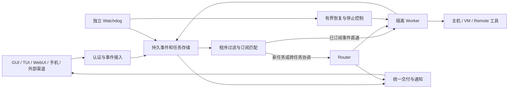

# DeepSeek Super-agent 概念与 CIBYP 可行性评估

日期：2026-11-02。本文是架构评估与建议，不表示功能已经实现或通过验收。既有钱包、量化与其他功能的状态仍以各自实现状态文档为准。

后续原生实现与实际范围参见 [SuperAgent 使用说明](super-agent-guide.md)。本评估保留研究时的基础与缺口判断，不把规划条目一并视为已交付。

## 研究对象与来源

用户指定的是 DeepSeek 新提出的《Super-agent 设计探索：迈向更自主的 Agent 系统》，不是安装 DeepSeek Harness，也不是把公开的 DSH 插件直接装进 CIBYP。

- [DeepSeek 中文设计原文](https://zhuanlan.zhihu.com/p/2099987320443237060)。本次直接抓取返回 403。
- [DeepSeek Harness 英文设计文章入口](https://x.com/DeepSeekHarness/status/2116857257245987236)。本次直接抓取返回 403。
- [标注原作者及原文链接的全文转载](https://blog2.eimoon.com/p/deepseek-super-agent-design/)。本次用来核读作者的设计正文，而非依赖媒体对能力的转述。原站全文本次未能独立取得，因此保留这一来源限制。
- [官方原型 README](https://github.com/deepseek-ai/dsh-superagent-prototype/blob/main/README.md)及[架构文档](https://github.com/deepseek-ai/dsh-superagent-prototype/blob/main/docs/007-architecture.md)。通过 GitHub 连接器实际读取，只用于交叉核对工程机制。README 明确指出公开原型不等于内部实现，也没有实现文章中的所有设计；不能用原型的功能边界替代概念本身。

## 判断

可以在 CIBYP 上实现这种形态，已有基础适合复用，但需要一项跨后台、持久化与前端交互的工程改造。不是换一个模型或增加一段系统提示词就能完成。

文章关注的是让系统承担会话组织与多任务协调：用户持续面对同一个协作者，系统维护任务归属、并发执行、后续事件与恢复过程。它强调连续、高效、主动、持久。Router 与 Worker 是逻辑职责，Worker 内部仍可包含子 Agent 或团队。

本文没有运行官方原型或复现其实验，不给出 CIBYP 的完成率、性能提升百分比或开发工期承诺。文章的初步实验使用合成事件与简化执行工具，其结果不能外推成真实开发任务质量或 CIBYP 的性能。

## CIBYP 当前基础与缺口

以下来自本次源代码核读，不是新的端到端验收结论。

| 能力 | 当前基础 | 达到目标仍需补充 |
| --- | --- | --- |
| 后台与前端解耦 | `src/main/agent-runtime.js`、`src/main/core/backend-server.js` 已提供共享运行时；`src/main/services/backend-transport.js` 可在无 GUI 时分发自动化和插件任务 | 原生 Super-agent 服务及唯一后台所有者；任务生命周期不由窗口承载 |
| 并发 Worker | `src/main/services/native-subagents.js` 已支持后台启动、消息、打断，复用同一 SDK 继续服务 | Router 与执行 Worker 的固定职责、跨入口任务归属、资源隔离和统一交付 |
| 会话消息与唤醒 | `src/main/ds-compat/agents.js` 已有带会话事件记录的 inbox 与唤醒机制 | 统一外部 Trigger 去重、Thread 订阅、关联索引和恢复后的交付对账 |
| 长任务 | `src/renderer/js/goal-state.js`、Agent 历史已有 Goal 导出恢复、暂停与预算边界 | Goal 与持久任务关联；等待、恢复、验收证据和最终完成分别建模，避免一次回复就代表整个工作完成 |
| 事件与自动化 | 自动化有定时、通知和 HTTP 来源，并经共享后台分发 | 两级过滤、事件突发批处理、后续事件直通、优先级与背压；现有前端事件回放缓冲不能充当持久任务日志 |
| 长程上下文 | `automatic-memory.js` 的独立记忆，以及已有上下文压缩和历史 | 按任务授权的引用图；Trigger → Thread → Task → Session → Artifact 的可续读检索，不能把所有历史混进一个记忆池 |
| 多设备执行 | `packages/remote/src` 已有认证、作用域及设备协议基础 | 执行租约、设备离线等待、重连结果对账、跨设备能力选择和持久在线部署 |
| 独立 Watchdog | 有局部停止、预算和恢复机制 | 在主任务之外观测实际进展的控制回路；它自身的权限、预算和干预审计 |

现有 `runSubAgent` 默认可以等待结果，选择后台启动也只是执行原语；这不能自动证明前台对所有耗时工具都具备全双工交互。自动化管理器中的旧注释仍写着渲染进程分发，但实际 `backend-transport.js` 已有后台承接，不能依据旧注释误判为必须打开 GUI。

## 建议架构

### 1. Router 作为轻量常驻服务

只处理用户交互、任务关联、分派和交付。通过工具注册层限制它不承担耗时 Shell、浏览器或完整开发工作，而不是仅靠提示词劝它委派。模型从现有模型池选择，Router 与 Worker 可以分别配置；不强制绑定 DeepSeek，也不依赖免费的模型端点。

“一个协作者”不是把所有用户和项目放进同一个模型上下文。按身份、项目和隐私域分区；跨项目引用经过权限检查。Babe 私人对话和记忆不默认进入团队或代码 Router。

### 2. 持久任务与事件层先于更多并发

为事件、讨论串、工作项、执行尝试、订阅、产物和交付建立稳定标识。区分任务尚未完成、当前 Worker 已结束、等待外部事件、等待用户，以及已验收完成。

数据库事务同时写入任务状态与待执行副作用；提交后才调用外部系统。消息采用可去重的投递与回执，执行使用租约与代次隔离。崩溃后重新核对结果，不能把“未收到返回”当成“从未执行”，尤其是发布、发消息和转账。不要承诺任意外部 API 都能获得严格 exactly-once 语义。

### 3. 两级过滤与事件直通

来源、身份、订阅、用户停止、黑白名单等先用确定性代码判断。只把需要语义判断的候选交给 Router；积压事件在有界时间与 token 预算内合并。同一任务的后续 CI、评论或设备结果直通对应 Worker，超出范围再交回 Router。

Worker 订阅同一 Thread 能共享事件，但事件共享本身不保证文件写入无冲突。代码任务需独立 worktree 或显式工作区锁；共同资源采用独立协调规则。

### 4. 可插话交互与按需上下文

耗时操作返回任务句柄；结果、失败和取消通过事件回传。用户可在后台执行期间追加、修正和叫停，不必等完整工具结束。保留普通同步工具入口，逐项迁移具有可靠取消和恢复语义的长操作。

上下文只内联近期相关信息与引用，完整工具输出和历史保存在外部，提供偏移、分页与按 ID 续读。跨渠道读取沿引用关系追溯，并在每一跳执行访问检查。摘要不是任务状态或原始证据的替代物。

### 5. 主动性与 Watchdog

主动策略由用户配置观察范围、可执行行为、费用、并发及通知条件。优先支持后台研究、复现、草稿和隔离修改，只在有成果、失败或需要决策时通知。

Watchdog 结合程序健康检查与有界的模型进展检查，识别重复动作、无新增证据、长期等待和方向偏移。恢复采用限定次数、退避与冷却；有审计记录。它不能自行扩大工具或钱包授权、解除人工急停，也不能把结果未知的有副作用操作直接重试。

### 6. 部署与产品体验

本机后台运行可以实现窗口关闭后继续，但电脑关机就无法继续计算。需要真正持续在线时，可部署到用户常开的服务器或 Mini 主机，执行环境通过 Remote 按需接入；设备离线时等待恢复。Micro 是受限工具设备，不承担 LLM 推理和任务协调。

前端提供统一协作者入口与任务中心：工作中、等待事件、需要我、已交付。保留项目与任务视图，底层 Worker 会话作为可展开细节。GUI、TUI、WebUI 和手机读取同一任务状态，避免另做一套聊天记录作为权威数据。

## 实施顺序与验收

1. 先做持久工作项、事件去重、订阅和 inbox/outbox，接现有 Worker。验收：重复或乱序事件、停止后迟到结果、进程中断、恢复后不重复交付。
2. 再加轻量 Router 和任务中心。验收：同一个入口交错提出三个任务，能独立推进；中途修正或停止只影响目标任务；已有任务后续事件不反复触发 Router。
3. 加全双工长工具和上下文引用。验收：耗时操作中仍能响应；长输出可续读；跨渠道准确恢复同一任务；不同项目和身份不会串读。
4. 最后加主动策略、Watchdog 与多设备持久运行。验收：无人介入时有界推进；无价值事件保持安静；设备离线和回归正确对账；既有权限和费用限制保持有效。

性能应测任务完成率、遗漏/误触发率、人工介入次数、前台响应 p50/p95、每个有效任务的模型费用，以及恢复和交付重复率。先与现有单会话加子 Agent 的基线比较，再决定额外复杂度是否值得。

推荐以 CIBYP 原生协调层实现，继续复用现有 Agent 循环、模型池、子 Agent、权限和 Remote；公开 DSH 原型作为设计参考，不引入另一套掌管整个应用的运行时。钱包和量化可以成为 Worker 的任务类型，但仍沿用已有独立授权与签名边界。
